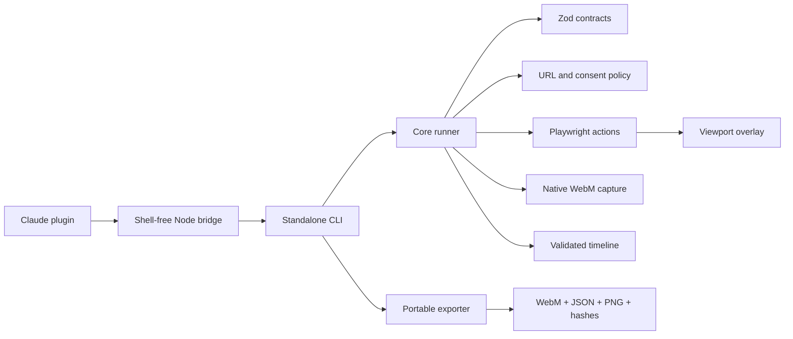

# Architecture

One npm package keeps install and CLI routing simple; modules retain clear boundaries.

`packages/shared` owns project/action/timeline/asset schemas, safe file helpers and abortable waits. `privacy` enforces URL and address policy. `browser` resolves locators and executes explicit actions; its fixture is synthetic. `cursor` initializes visual/masking scripts and records viewport positions. `recorder` validates WebM containers. `core` owns sessions, budgets, approval checks, sequential timeline records and cleanup. `exporters` independently validates and copies assets. `cli` handles argument parsing, exit codes and the local demo server. `adapters` defines the future provider-neutral `TutorialAdapter` interface; it does not claim an implemented Codex/orchestrator integration.

`runProject(input, options)` validates the plan and network, checks declared approvals, creates a unique output, launches an isolated Chromium context, installs policies/overlays, performs initial navigation and actions sequentially, and finalizes on success or failure. Fatal action/network errors stop subsequent actions. An AbortController cancels all explicit delays; context closure cancels browser operations. Execution is settled before exporting the timeline. Users can inspect failed runs, but only successful validated runs may be exported.

The original reusable plan is user-owned input; the run project.json is an export-safe summary, not a replay plan. Timeline metadata omits typed values and uses host monotonic milliseconds relative to page creation. Native video timing is approximate. Export compatibility is versioned and standalone; actual Video Workflow importer support is pending. See ARCHITECTURE_DECISIONS.md and EXPORT_FORMAT.md.
